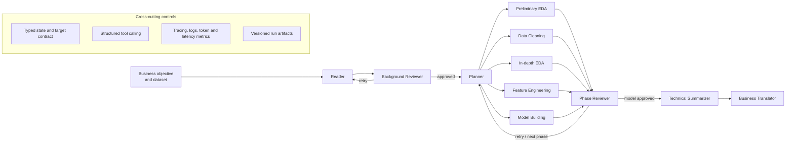

# Automated Data Science

## Industrial Architecture and Engineering Overview

Automated Data Science is a multi-agent system that turns a natural-language business objective and a tabular dataset into a reproducible machine-learning workflow. It combines LLM-based reasoning with deterministic data and ML tooling to automate task understanding, exploratory analysis, data cleaning, feature engineering, model selection, validation, and technical/business reporting.

The project is designed as an engineering reference architecture for agentic AI in data science. Its central idea is that an LLM may propose and review decisions, but production code—not generated scripts—must execute data transformations and model training.

> Project status: validated research/engineering prototype. It demonstrates production-oriented architecture and controls, but it is not presented as a fully managed, multi-tenant production platform.

## The Engineering Problem

Traditional AutoML systems optimize a predefined model search space but often assume that the target, metric, schema, and data-cleaning strategy are already known. Fully autonomous coding agents are more flexible, but unrestricted code generation introduces different risks: hallucinated columns, unsafe execution, data leakage, inconsistent artifacts, and limited reproducibility.

This system addresses the gap with a constrained agentic workflow:

- Accept a natural-language objective instead of requiring a fully specified ML configuration.
- Infer and review the task contract from dataset evidence.
- Use LLMs for planning and critique while restricting execution to typed, allow-listed tools.
- Protect target and identifier columns throughout the pipeline.
- Preserve run artifacts, metrics, traces, token usage, and reports for audit and replay.
- Support multiple model providers without coupling the workflow to one vendor.

## System Architecture

The workflow is implemented as a LangGraph state machine. Conditional routing allows a reviewer to approve a phase, request replanning, or terminate safely. A shared typed state carries the task definition, dataset paths, target specification, findings, plans, metrics, review results, and artifact references across agents.

## Core Industrial Design Decisions

### 1. Separate reasoning from execution

The Planner returns a Pydantic-validated `ToolCallPlan`; it does not generate arbitrary Python for direct execution. Data operations are implemented as deterministic functions in an allow-listed tool layer. This design improves testability, constrains the execution surface, and makes failures attributable to a specific plan step.

Representative tools include missing-value treatment, outlier clipping, categorical encoding, binning, interaction creation, profiling, metric selection, and model evaluation.

### 2. Treat the ML task as a contract

The `target_spec` contract records target columns, identifier columns, task family, prediction semantics, submission schema, metric hints, and supporting evidence. It supports:

- Binary classification
- Multiclass classification
- Regression
- Multilabel classification
- Single- and multi-target workflows

Downstream phases consume the same authoritative contract instead of independently re-inferring the target. Compatibility mirrors are retained for components still migrating to the newer schema.

### 3. Enforce data-safety guardrails

Target and identifier columns are protected at both planning and execution time. The system blocks transformations that would drop, encode, bin, or otherwise corrupt protected columns. It also aligns train/test feature schemas, excludes target and ID fields from selected features, and records rejected operations as data-quality flags.

These controls reduce common autonomous-ML failure modes such as target leakage, invalid submission schemas, and train/serve feature mismatch.

### 4. Use review gates instead of a linear chain

Each execution phase returns to a Reviewer before the workflow advances. The Reviewer can approve, request a retry, or abort. Task understanding is also exposed for human confirmation before expensive execution. This creates explicit control points for human-in-the-loop operation and safer failure recovery.

### 5. Keep model providers replaceable

The LLM layer parses provider-qualified model identifiers and routes calls through provider adapters. The current implementation supports Anthropic and OpenAI-compatible endpoints, including compatible hosted-model services. Agent-level configuration allows different phases to use different models without rewriting workflow logic.

### 6. Make every run observable

Each run receives an isolated artifact directory and emits structured JSONL events for workflow start/end, node start/result, errors, review status, and latency. Token usage is aggregated by module, and LangSmith integration provides a single root trace with nested agent and LLM calls.

Generated observability assets include:

- Node-latency and waterfall charts
- Input/output/total token breakdowns
- Per-module LLM call counts
- Recent prompt/response diagnostics with truncation
- Local logs plus optional cloud traces
- Run manifests linking models, predictions, reports, figures, and processed data

This makes cost, latency, failure location, and agent behavior inspectable rather than hidden inside an opaque autonomous loop.

## End-to-End Capability

Given a task such as `predict customer churn` and a dataset directory, the system can:

1. Discover train, test, sample-submission, and dataset-description files.
2. Infer the task family, target scope, identifiers, output schema, and candidate metrics.
3. Profile distributions, missingness, target behavior, and feature types.
4. Plan and execute guarded cleaning and feature-engineering operations.
5. Train and cross-validate candidate scikit-learn/XGBoost models.
6. Select a model using a task-appropriate primary metric.
7. Persist the model, predictions, processed datasets, metrics, and visualizations.
8. Produce both an engineering report and a stakeholder-oriented business report.

The workflow runs locally or through Docker Compose and uses the same mounted `data/` and `artifacts/` contract in both environments.

## Evaluation Evidence

The repository includes a cross-framework evaluation harness covering eight public tabular tasks across binary classification, multiclass classification, regression, and multilabel classification. The extended matrix executes three runs per framework/task and records model quality, output validity, runtime, variability, token consumption, and LLM call count.

For this project's workflow, the recorded matrix reports valid outputs on all 24 evaluated runs (`8 tasks × 3 runs`). Selected results include:

| Task | Metric | Mean score | Reproducibility std. | Valid runs |
| --- | --- | ---: | ---: | ---: |
| Spaceship Titanic | Accuracy | 0.8003 | 0.0044 | 3/3 |
| Titanic | ROC AUC | 0.8758 | 0.0024 | 3/3 |
| Bank churn | ROC AUC | 0.8890 | 0.0001 | 3/3 |
| Obesity risk | Macro F1 | 0.8924 | 0.0007 | 3/3 |
| Plate defect | Macro OvR ROC AUC | 0.8752 | 0.0009 | 3/3 |

The benchmark also compares AIDE, LightAutoDS/LAMA, and AutoKaggle. Results show that no framework dominates every task: this workflow wins selected quality comparisons but often spends more runtime and tokens than lighter systems. That trade-off is intentionally visible. The engineering objective is governed, inspectable automation—not an unsupported claim of universal state-of-the-art performance.

See [`tests/system_reports/framework-matrix-extended-20260515-v2.md`](tests/system_reports/framework-matrix-extended-20260515-v2.md) for the full methodology and results.

## Reliability and Governance Controls

| Risk | Implemented control |
| --- | --- |
| Hallucinated or malformed plans | Pydantic schemas and allow-listed tools |
| Arbitrary generated-code execution | Deterministic execution layer for core data operations |
| Target leakage | Central target contract, protected columns, leakage checks |
| Train/test schema drift | Explicit feature alignment and output-schema validation |
| Silent agent failure | Reviewer gates, structured error envelopes, phase status |
| Poor reproducibility | Per-run directories, manifests, persisted plans and artifacts |
| Vendor lock-in | Provider-qualified model routing and adapter interfaces |
| Uncontrolled LLM cost | Per-module token and call-count instrumentation |
| Secret exposure | Environment-based configuration; real `.env` files are Git-ignored |

## Technology Stack

- Python 3.13
- LangGraph and LangChain
- Pydantic structured outputs
- OpenAI-compatible and Anthropic provider adapters
- pandas, NumPy, scikit-learn, XGBoost
- LangSmith plus local JSONL observability
- pytest and pytest-asyncio
- Docker and Docker Compose

## Current Production Boundary

The repository demonstrates production-minded system design, but several platform capabilities remain outside its current scope:

- The primary interface is a CLI/demo web application, not a hardened multi-tenant API.
- Artifacts are stored on the local filesystem rather than an object store and model registry.
- `.env` configuration should be replaced by a managed secrets service in production.
- There is no distributed job queue, autoscaling worker pool, tenant isolation, RBAC, or quota service.
- Offline evaluation is implemented; online drift, data-quality, and business-KPI monitoring are not.
- Dataset licensing, PII classification, retention, and deletion policies require deployment-specific governance.
- Benchmark figures are offline experimental results and should not be interpreted as production SLAs.

## Productionization Roadmap

A practical path from this prototype to an internal AI/ML platform would be:

1. Expose task submission and run inspection through a versioned FastAPI service.
2. Move execution to isolated queue workers with CPU/memory/time budgets and cancellation.
3. Store state and metadata in PostgreSQL; place datasets and artifacts in object storage.
4. Add a model registry, dataset lineage, approval records, and immutable audit events.
5. Integrate a secrets manager, SSO/RBAC, tenant isolation, and policy-based tool permissions.
6. Export traces and metrics through OpenTelemetry and add SLOs for success rate, latency, and cost.
7. Add continuous data validation, model-drift monitoring, and human approval before deployment.
8. Introduce sandboxed extension points for custom transformations while preserving the deterministic core.

## Why This Project Matters

This project demonstrates more than prompt orchestration. It treats agentic AI as a software and ML systems problem: typed contracts, explicit state transitions, constrained execution, evaluation harnesses, provider abstraction, observability, reproducible artifacts, and honest production boundaries.

That combination is the foundation required to move LLM agents from demos toward dependable AI engineering systems.
