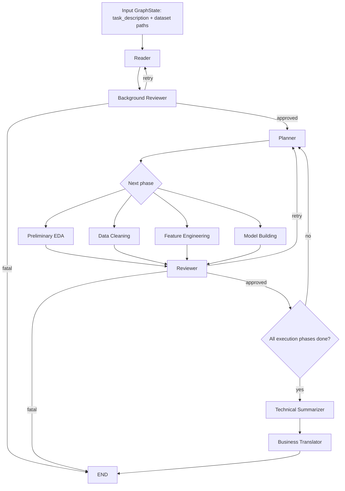

# MVP Implementation Summary

This document summarizes the current implementation status of the MVP multi-agent data science workflow. It does not repeat the full design specification; instead, it explains how the current code moves a task from data ingestion, planning, execution, and review to report generation.

## 1. MVP in One Sentence

The current MVP is a LangGraph-based multi-agent data science pipeline.

After the user provides task configuration and dataset paths, the system follows the `Reader -> Background Reviewer -> Planner -> Data Science Execution Phases -> Reviewer -> Technical Summarizer -> Business Translator` chain to progressively produce EDA outputs, cleaned data, engineered features, model results, prediction files, a technical report, and a business report.

The core collaboration model is a shared `GraphState`. Agents do not pass parameters directly to the next agent. Each agent reads the state buckets it needs and returns only the partial state updates it owns.

## 2. Multi-Agent Architecture Flow

The following diagram is taken from [mvp_workflow_call_chain.md](mvp_workflow_call_chain.md). It shows the MVP main call chain and review gate.



## 3. Current Implementation Entry Points

### 3.1 Graph Construction

The LangGraph workflow is built by `build_workflow()` in `app/graph/workflow.py`.

The currently registered nodes are:

| Node                    | Implementation entry point                      | Responsibility                                                          |
| ----------------------- | ----------------------------------------------- | ----------------------------------------------------------------------- |
| `reader`              | `app/graph/nodes/reader_node.py`              | Initialize task understanding and dataset paths                         |
| `background_reviewer` | `app/graph/nodes/bg_reviewer_node.py`         | Validate Reader output before formal planning                           |
| `planner`             | `app/graph/nodes/planner_node.py`             | Decide the next workflow phase                                          |
| `preliminary_eda`     | `app/graph/nodes/prelim_eda_node.py`          | Generate the initial data profile and EDA report                        |
| `data_cleaning`       | `app/graph/nodes/data_cleaning_node.py`       | Generate and execute data-cleaning tool calls                           |
| `indepth_eda`         | `app/graph/nodes/indepth_eda_node.py`         | Reserved node for deeper EDA                                            |
| `feature_engineering` | `app/graph/nodes/feature_engineering_node.py` | Generate and execute feature-engineering tool calls                     |
| `model_building`      | `app/graph/nodes/modeling_node.py`            | Train candidate models, select the best model, and generate predictions |
| `reviewer`            | `app/graph/nodes/reviewer_node.py`            | Review execution-phase outputs                                          |
| `summarizer`          | `app/graph/nodes/summarizer_node.py`          | Generate the technical report                                           |
| `business_translator` | `app/graph/nodes/business_translator_node.py` | Generate the business report and action recommendations                 |

`build_workflow(stop_after_technical_summary=True)` stops after the technical report is generated and does not enter `business_translator`. The current CLI demo uses this mode.

By default, `build_workflow()` continues into `business_translator` and generates the business report.

### 3.2 CLI Entry Point

`run_multiagent.py` is the most direct MVP runtime entry point.

It currently supports the Titanic dataset and constructs a built-in `GraphState`:

- Train dataset: `data/titanic/train.csv`
- Test dataset: `data/titanic/test.csv`
- Sample submission: `data/titanic/gender_submission.csv`
- Target column: `Survived`
- Task type: `classification`
- Metric hint: `accuracy,f1,roc_auc`

Run command:

```bash
python run_multiagent.py titanic
```

The script uses `graph.astream(..., stream_mode="debug")` to print node-level progress. After the technical report phase completes, it reads `artifacts/reports/technical_report.md`.

## 4. GraphState Contract

The MVP's core state is defined in `app/schemas/state_schema.py`. The major buckets are:

| State bucket              | Current responsibility                                                                             |
| ------------------------- | -------------------------------------------------------------------------------------------------- |
| `task_config`           | Task ID, task type, target column, metric hint, dataset paths, and business context                |
| `problem_understanding` | Reader-produced task understanding, candidate metrics, risks, and business-goal summary            |
| `execution_plan`        | Planner-produced phase list, phase objectives, success criteria, review points, and fallback rules |
| `current_phase`         | The phase that just completed or will be executed next; used by nodes and routers                  |
| `phase_history`         | Append-only phase history used by the Planner to determine which phases have already run           |
| `data_state`            | Raw/current dataset paths, schema, EDA findings, cleaning summary, and data-quality flags          |
| `feature_state`         | Engineered dataset paths, selected features, dropped features, and feature-transform summary       |
| `model_state`           | Candidate models, best model, parameters, validation metrics, CV results, and prediction path      |
| `review_state`          | Latest review status, review history, retry counts, fatal errors, and pending review phase         |
| `report_state`          | Technical report path, business report path, summary, limitations, and action recommendations      |
| `artifacts`             | Unified index of all persisted artifacts                                                           |
| `runtime_state`         | Thread ID, workspace, runtime statistics, interruption state, and last reviewed phase              |
| `messages`              | Node runtime messages stored as serializable logs                                                  |

`phase_history` and `messages` use LangGraph reducers for append behavior. Other nested fields are usually manually merged by each node: the node reads the old value, updates the fields it owns, and returns the merged structure.

## 5. Agent Implementation Status

### 5.1 Reader

Implementation file: `app/agents/reader.py`

Reader converts the input task configuration into workflow-consumable task understanding:

- Resolves train/test CSV paths under `workspace_root`.
- Reads CSV metadata, including column names, types, missingness, shape, and a small sample.
- Infers or confirms the target column.
- Infers the task type, defaulting to classification.
- Generates candidate metrics, risk items, and a data overview.
- Calls `profile_dataset()` to produce lightweight `data_state.eda_findings`.
- Can call the LLM through `complete_json()`; if the LLM is unavailable, it uses a deterministic fallback.

Key outputs:

- `problem_understanding`
- `data_state.raw_train_path`
- `data_state.current_train_path`
- `data_state.target_column`
- `data_state.eda_findings`
- `current_phase = "reader"`

### 5.2 Background Reviewer

Implementation file: `app/agents/bg_reviewer.py`

Background Reviewer checks whether Reader output is good enough to enter formal planning:

- Checks whether the training file exists and is readable.
- Checks whether the target column is empty or missing from the training dataset.
- Checks `problem_understanding.task_summary`, candidate metrics, and related fields.
- Missing paths or unreadable data cause a direct fatal status.
- Fixable missing fields cause a retry.
- Uses `complete_json()` to generate a review comment; if the LLM is unavailable, it uses a fallback comment.

Key outputs:

- `review_state.latest_review_status`
- `review_state.review_history`
- `review_state.retry_count_by_phase`
- `review_state.pending_review_phase = "reader"`
- `runtime_state.interrupted`

### 5.3 Planner

Implementation file: `app/agents/planner.py`

Planner currently combines LLM output with deterministic fallback logic:

- The supported MVP execution phases are:
  - `preliminary_eda`
  - `data_cleaning`
  - `feature_engineering`
  - `model_building`
- If the reviewer returns `retry`, Planner prioritizes repeating `pending_review_phase`.
- If there is no retry, Planner follows the fixed MVP phase order and selects the first incomplete phase.
- Uses `complete_json()` to generate phase objectives, success criteria, and fallback rules.
- Falls back to the fixed phase order and default success criteria when LLM output is invalid or unavailable.

Note: the `indepth_eda` node is registered in the graph, but `PlannerAgent.supported_phases` does not currently include it, so it is not part of the default MVP main path.

### 5.4 Preliminary EDA

Implementation file: `app/agents/preliminary_eda.py`

Preliminary EDA reads the current train/test data and generates a data profile for both machines and humans:

- Validates the training dataset path.
- Uses `profile_dataset()` to generate a structured profile.
- Writes `data_state.schema_summary` and `data_state.eda_findings`.
- Generates `artifacts/eda/preliminary_eda.md`.
- If missing values exist, generates `artifacts/figures/eda_missingness.png`.

Key outputs:

- `data_state.schema_summary`
- `data_state.eda_findings`
- `artifacts.preliminary_eda_report`
- `artifacts.figures`

### 5.5 Data Cleaning

Implementation file: `app/agents/data_cleaning.py`

Data Cleaning uses the EDA profile to generate a cleaning plan and execute tool calls:

- Reads `data_state.current_train_path` and `data_state.current_test_path`.
- Requires `data_state.eda_findings` to exist.
- Calls structured LLM planning through `BasePlanner(agent_name="data_cleaning")`.
- Dynamically calls tool functions from `app.tools.cleaning_tools`.
- Outputs cleaned train/test CSV files.
- Writes the cleaning report.

Key outputs:

- `artifacts/data/cleaned_train.csv`
- `artifacts/data/cleaned_test.csv`
- `artifacts/data/cleaning_report.md`
- `data_state.current_train_path`
- `data_state.current_test_path`
- `data_state.cleaning_summary`

### 5.6 Feature Engineering

Implementation file: `app/agents/feature_engineering.py`

Feature Engineering rebuilds a fresh profile from the cleaned data and generates feature-engineering tool calls:

- Reads the cleaned train/test datasets.
- Uses `profile_dataset()` to generate a fresh profile.
- Calls structured LLM planning through `BasePlanner(agent_name="feature_engineering")`.
- Dynamically calls tool functions from `app.tools.feature_tools`.
- Saves engineered train/test datasets.
- Generates `feature_summary.json`.

Key outputs:

- `artifacts/features/engineered_train.csv`
- `artifacts/features/engineered_test.csv`
- `artifacts/features/feature_summary.json`
- `feature_state.engineered_train_path`
- `feature_state.engineered_test_path`
- `feature_state.selected_features`
- `feature_state.feature_transform_summary`

### 5.7 Model Building

Implementation file: `app/agents/model_building.py`

Model Building has moved most modeling logic into the tool layer, mainly delegating to `app/tools/model_tools.py` and `app/tools/metric_tools.py`:

- Reads engineered train/test datasets.
- Confirms that the target column exists.
- Splits `X_train`, `y_train`, and `X_test`.
- Automatically detects numeric and categorical features.
- Builds the sklearn preprocessor.
- Gets candidate models.
- Uses GridSearchCV to train and select the best model.
- Generates test predictions.
- Saves model results, the best model, and the submission file.
- Computes training-set evaluation metrics and writes them back to state.

Key outputs:

- `artifacts/models/model_results.json`
- `artifacts/models/best_model.pkl`
- `artifacts/predictions/submission.csv`
- `model_state.candidate_models`
- `model_state.best_model_name`
- `model_state.validation_metrics`
- `model_state.cv_results`
- `model_state.prediction_path`
- `model_state.baseline_metrics`

### 5.8 Reviewer

Implementation file: `app/agents/reviewer_agent.py`

Reviewer is the quality gate for execution phases:

- Calls deterministic checks in `app.tools.reviewer_tools` for `preliminary_eda`, `data_cleaning`, `feature_engineering`, and `model_building`.
- Allows at most three retries per phase.
- Returns `approved` when the deterministic check passes.
- Returns `retry` when the check fails but the retry limit has not been reached.
- Returns `fatal` when the retry limit is reached or a fatal condition is detected.
- Uses the LLM only to generate the review comment; the LLM does not override hard-check decisions.

Key outputs:

- `review_state.latest_review_status`
- `review_state.review_history`
- `review_state.retry_count_by_phase`
- `review_state.fatal_errors`
- `runtime_state.last_reviewed_phase`
- `runtime_state.interrupted`

### 5.9 Technical Summarizer

Implementation file: `app/agents/summarizer.py`

Technical Summarizer generates the technical report only after the final execution phase has been approved:

- Trigger condition: `current_phase == "model_building"` and `review_state.latest_review_status == "approved"`.
- Summarizes task, data, features, model state, review history, and artifacts.
- Uses `complete_json()` to generate report content.
- Uses a fallback renderer when the LLM is unavailable.
- Writes `artifacts/reports/technical_report.md`.
- Records file-write failures in `review_state.fatal_errors`.

Key outputs:

- `current_phase = "technical_summary"`
- `report_state.technical_report_path`
- `report_state.executive_summary`
- `report_state.limitations`
- `artifacts.technical_report`

### 5.10 Business Translator

Implementation file: `app/agents/business_translator.py`

Business Translator is currently a deterministic implementation:

- Reads the technical report, validation metrics, feature importance, business context, and limitations.
- Generates a stakeholder-friendly executive summary.
- Generates action recommendations from metrics, top drivers, task type, and limitations.
- Writes `artifacts/reports/business_report.md`.

Key outputs:

- `current_phase = "business_translation"`
- `report_state.business_report_path`
- `report_state.executive_summary`
- `report_state.recommended_actions`
- `artifacts.business_report`

## 6. Tool-Layer Implementation

The current MVP has a clear tool-layer structure:

| Tool module                                         | Responsibility                                                                               |
| --------------------------------------------------- | -------------------------------------------------------------------------------------------- |
| `app/tools/profiler.py`                           | Generate data profiles for Reader, EDA, and planner context                                  |
| `app/tools/cleaning_tools.py`                     | Data-cleaning tool functions dynamically called by Data Cleaning                             |
| `app/tools/feature_tools.py`                      | Feature-engineering tool functions dynamically called by Feature Engineering                 |
| `app/tools/model_tools.py`                        | Candidate models, preprocessing, training, selection, persistence, and submission generation |
| `app/tools/metric_tools.py`                       | Unified classification/regression metric bundle computation                                  |
| `app/tools/reviewer_tools.py`                     | Deterministic review checks for each execution phase                                         |
| `app/tools/artifact_tools.py` / `file_tools.py` | Artifact and file-path helpers                                                               |

Data Cleaning and Feature Engineering use `BasePlanner` to generate a `ToolCallPlan`, then map each plan step to an underlying tool function. This keeps the LLM responsible for planning while Python tools remain responsible for execution.

## 7. Default Artifact Paths

The default artifact contract is defined in `app/schemas/artifact_schema.py`:

| Artifact key               | Default path                                |
| -------------------------- | ------------------------------------------- |
| `preliminary_eda_report` | `artifacts/eda/preliminary_eda.md`        |
| `cleaned_train_data`     | `artifacts/data/cleaned_train.csv`        |
| `cleaned_test_data`      | `artifacts/data/cleaned_test.csv`         |
| `cleaning_report`        | `artifacts/data/cleaning_report.md`       |
| `in_depth_eda_report`    | `artifacts/eda/in_depth_eda.md`           |
| `feature_summary`        | `artifacts/features/feature_summary.json` |
| `model_results`          | `artifacts/models/model_results.json`     |
| `best_model`             | `artifacts/models/best_model.pkl`         |
| `prediction_file`        | `artifacts/predictions/submission.csv`    |
| `technical_report`       | `artifacts/reports/technical_report.md`   |
| `business_report`        | `artifacts/reports/business_report.md`    |
| `figures`                | `[]`                                      |

## 8. Routing and Review Gate

Routing is defined in `app/graph/routes.py`.

The main rules are:

- `route_after_planner(state)` returns `state.current_phase` and requires it to belong to `PHASE_SEQUENCE`.
- `route_after_reviewer(state)`:
  - `approved` -> next step
  - `fatal` -> `END`
  - all other cases -> `retry`
- `route_after_summarizer(state)`:
  - routes to the final path when the phase is `model_building` or `technical_summary`
  - otherwise routes back to planner

Inside the graph:

- Background reviewer `approved` routes to planner.
- Background reviewer `retry` routes back to reader.
- Every execution phase routes to reviewer after completion.
- Reviewer `retry` routes back to planner, and planner decides which phase to rerun.
- Reviewer `fatal` ends the workflow.

## 9. LLM Usage

The current project centralizes LLM calls in the `app/llm/` service layer:

- `complete_json()` is used by agents that need JSON payloads, such as Reader, Planner, and Summarizer.
- `render_text()` is used for Reviewer comments.
- `BasePlanner` uses `LLMService.chat(..., response_schema=ToolCallPlan)` to obtain strongly typed tool-call plans.
- Each agent can use agent-specific environment configuration to control model, temperature, max tokens, and whether the LLM is enabled.

This means the MVP can connect to a real LLM while still preserving fallback paths for unit tests and non-LLM environments.

## 10. Current Test Coverage

Current tests mainly cover:

- `GraphState` default structure and artifact-key smoke tests.
- Reader initialization of task understanding and dataset paths.
- Background Reviewer approved / retry / fatal paths.
- Technical Summarizer no-op behavior and final report generation.
- Planner phase selection and tracing.
- Reviewer Agent phase-review logic.
- Model Building error paths, normal training path, artifact file generation, submission structure, and NaN handling.
- LLM service, router, providers, and structured-output service-layer tests.

Representative test files:

- `tests/integration/test_state_smoke.py`
- `tests/unit/test_reader_bg_reviewer_summarizer.py`
- `tests/unit/test_planner_agent.py`
- `tests/unit/test_reviewer_agent.py`
- `tests/unit/test_model_building.py`
- `tests/unit/test_model_tools.py`
- `tests/unit/test_metric_tools.py`

## 11. Current Boundaries and Gaps

The current MVP already has a runnable main-chain skeleton, but a few implementation boundaries remain:

1. `run_multiagent.py` currently stops at Technical Summarizer by default and does not output the Business Report.
2. The `business_translator` node is implemented and included in the full graph by default, but the CLI demo does not enable the full business-report path.
3. The `indepth_eda` node is registered, but `PlannerAgent` does not select it by default.
4. Data Cleaning and Feature Engineering depend on the structured LLM planner to generate tool calls. When LLM configuration is unavailable, these phases do not yet have the same complete fallback behavior as Reader and Summarizer.
5. Some phases still contain Titanic-specific assumptions, such as the weak `Survived` fallback in EDA and Feature Engineering.
6. The review gate is currently centered on deterministic artifact/state checks; LLM comments are explanatory only.
7. Model Building metrics are currently based mainly on training-set predictions and CV summaries. Future work can add stricter validation splits, holdout evaluation, or leaderboard-style evaluation.

## 12. MVP Completion Summary

The current project has implemented the core MVP loop:

```text
TaskConfig + DatasetPaths
-> Reader initializes task understanding and data state
-> Background Reviewer performs the entry quality gate
-> Planner selects execution phases
-> Preliminary EDA generates the data profile
-> Data Cleaning generates cleaned data and a cleaning report
-> Feature Engineering generates engineered data and a feature summary
-> Model Building trains models and generates the submission
-> Reviewer applies approve/retry/fatal gates to key phases
-> Technical Summarizer generates the technical report
-> Business Translator can generate the business report
```

From an engineering perspective, the MVP's key value is:

- It uses `GraphState` to unify the multi-agent data contract.
- It uses LangGraph to orchestrate nodes and review gates into a recoverable, extensible workflow.
- It uses deterministic tools to execute actual data science operations, reducing the risk of letting the LLM directly mutate data.
- It uses reviewer gates to bring each phase's artifacts and state fields under quality control.
- It uses report nodes to turn technical outputs into deliverable documents.
