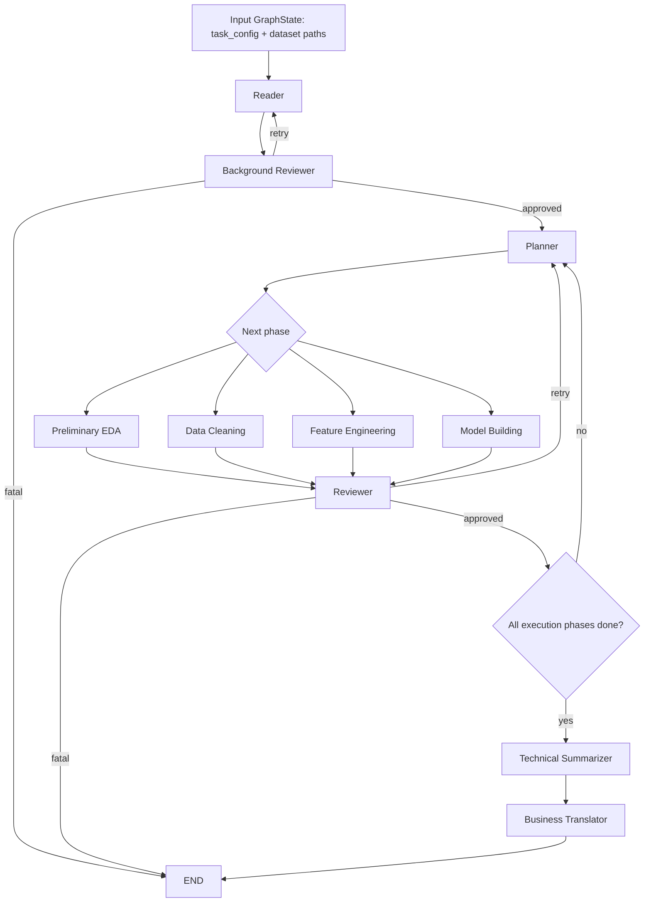

# MVP Workflow Call Chain

本文件定义一次数据集和任务进入系统后，如何通过 LangGraph 主链路跑完整个数据科学流程，并最终输出 business report。

它描述的是 MVP 的目标调用链。当前代码中部分节点和工具仍未实现，具体缺口见文末 checklist。

## 1. 一句话理解

可以把整个系统理解成一条生产线：

```text
用户给任务和数据路径
-> Reader 理解任务
-> Planner 决定下一步
-> Developer 执行一个数据科学阶段
-> Reviewer 检查该阶段是否合格
-> Planner 继续安排下一阶段
-> Technical Summarizer 汇总技术报告
-> Business Translator 转成业务报告
-> 结束
```

这里的 `GraphState` 就是一份共享工作台。每个 agent 只从工作台读取自己需要的字段，然后把本阶段结果写回工作台。agent 之间不直接互相传参数。

## 2. MVP 成功标准

一次 MVP run 成功，需要同时满足：

| 检查项 | 预期结果 |
| --- | --- |
| LangGraph 入口 | `main.py` 能构造 `GraphState` 并调用 `graph.invoke(...)` |
| 持久运行标识 | invocation 传入 `configurable.thread_id` |
| 数据工件 | 生成 cleaned data、feature summary、model results |
| 提交文件 | 生成 `artifacts/predictions/submission.csv` |
| 技术报告 | 生成 `artifacts/reports/technical_report.md` |
| 业务报告 | 生成 `artifacts/reports/business_report.md` |
| Review gate | 每个关键阶段都有 reviewer 的 approved/retry/fatal 结论 |
| 最终状态 | `report_state.business_report_path` 非空，且文件存在 |

## 3. 最小输入

系统启动时，调用方至少要提供这些字段：

```python
GraphState(
    task_config=TaskConfig(
        task_id="titanic-mvp-001",
        task_type="classification",
        target_column="Survived",
        metric_hint="accuracy",
        dataset_paths=DatasetPaths(
            train="data/titanic/train.csv",
            test="data/titanic/test.csv",
            submission="data/titanic/gender_submission.csv",
        ),
        business_context="Predict passenger survival and explain useful decision signals.",
    ),
    runtime_state=RuntimeState(
        thread_id="titanic-mvp-001",
        checkpoint_namespace="default",
        workspace_root=".",
    ),
)
```

入口调用必须带 thread id：

```python
graph.invoke(
    state,
    config={"configurable": {"thread_id": state.runtime_state.thread_id}},
)
```

## 4. 核心状态字段

非 LangGraph 背景的人只需要记住这些桶：

| State bucket | 用途 |
| --- | --- |
| `task_config` | 用户给的任务、目标列、数据路径、业务背景 |
| `problem_understanding` | Reader 对任务和数据的理解 |
| `execution_plan` | Planner 当前计划、下一个阶段、验收标准 |
| `data_state` | 原始数据、当前数据、清洗摘要、EDA 发现 |
| `feature_state` | 工程化数据路径、特征列表、特征变换摘要 |
| `model_state` | 模型列表、最佳模型、指标、预测文件路径 |
| `review_state` | reviewer 结论、重试次数、错误记录 |
| `report_state` | technical report 和 business report 的路径与摘要 |
| `artifacts` | 所有落盘文件的统一索引 |
| `runtime_state` | thread id、workspace、运行中断标志 |
| `messages` | LLM 或 code execution 的可序列化消息记录 |

状态传递规则：

| 规则 | 说明 |
| --- | --- |
| 只返回局部更新 | 每个节点返回 `dict`，只包含它负责写的 state bucket |
| 不直接传参 | 节点之间只通过 `GraphState` 共享信息 |
| 文件走 artifacts | CSV、Markdown、PNG、PKL 都要写入 `artifacts` 对应 key |
| `phase_history` 追加 | 节点返回 `{"phase_history": ["phase_name"]}`，由 reducer 追加 |
| 嵌套 list 手动合并 | `artifacts.figures` 和 `review_state.review_history` 需要节点自己读旧值再追加 |
| 错误标准化 | 失败时写 `review_state.fatal_errors` 或 reviewer 结论，不直接让主链路静默失败 |

## 5. 主调用链



MVP phase 顺序固定为：

```text
reader
-> bg_reviewer
-> planner
-> preliminary_eda
-> reviewer
-> planner
-> data_cleaning
-> reviewer
-> planner
-> feature_engineering
-> reviewer
-> planner
-> model_building
-> reviewer
-> technical_summary
-> business_translation
-> END
```

`indepth_eda` 暂时不进入 MVP 主链路。它可以保留接口，后续作为 planner 可选分支加入。

## 6. 每个节点的读写和工具调用

### 6.1 Reader

职责：把用户给的任务和数据路径变成系统可用的任务理解。

| 项 | 内容 |
| --- | --- |
| 入口函数 | `run_reader(state)` |
| 读取 | `task_config.dataset_paths`, `task_config.target_column`, `task_config.task_type`, `task_config.metric_hint`, `task_config.business_context` |
| 工具调用 | `file_tools.ensure_artifact_parent` 或等价路径检查；`pandas.read_csv(..., nrows=...)` 读取小样本；可选调用 `profiler.profile_dataset` 做轻量 schema 摘要 |
| 写入 | `problem_understanding`, `data_state.raw_train_path`, `data_state.raw_test_path`, `data_state.current_train_path`, `data_state.current_test_path`, `data_state.target_column`, `data_state.train_shape`, `data_state.test_shape`, `current_phase`, `phase_history` |

预期输出示例：

```python
{
    "problem_understanding": {
        "task_summary": "Binary classification on Titanic survival.",
        "predicted_task_type": "classification",
        "target_column": "Survived",
        "candidate_metrics": ["accuracy", "f1", "roc_auc"],
        "risks": ["Small dataset", "Missing Age and Cabin values"],
        "business_goal_summary": "Explain survival signals in business-friendly language.",
    },
    "data_state": {
        "raw_train_path": "data/titanic/train.csv",
        "raw_test_path": "data/titanic/test.csv",
        "current_train_path": "data/titanic/train.csv",
        "current_test_path": "data/titanic/test.csv",
        "target_column": "Survived",
    },
    "current_phase": "reader",
    "phase_history": ["reader"],
}
```

### 6.2 Background Reviewer

职责：在正式执行前检查 Reader 是否把任务讲清楚。

| 项 | 内容 |
| --- | --- |
| 入口函数 | `run_bg_reviewer(state)` |
| 读取 | `problem_understanding`, `data_state.current_train_path`, `data_state.current_test_path`, `task_config.target_column` |
| 工具调用 | 文件存在检查；schema target 检查 |
| 写入 | `review_state.latest_review_status`, `review_state.review_history`, `review_state.last_review_comment`, `review_state.pending_review_phase`, `runtime_state.last_reviewed_phase`, `runtime_state.interrupted` |

review 规则：

| 情况 | 状态 |
| --- | --- |
| 数据路径存在且 target 明确 | `approved` |
| 缺少 target 或路径可修复 | `retry` |
| 数据文件不存在或无法读取 | `fatal` |

### 6.3 Planner

职责：决定下一步执行哪个 phase，并把本 phase 的成功标准写到 state。

MVP 阶段不要先做复杂 LLM planning。先做确定性 planner，保证主链路能跑。

| 项 | 内容 |
| --- | --- |
| 入口函数 | `run_planner(state)` |
| 读取 | `phase_history`, `review_state.latest_review_status`, `review_state.retry_count_by_phase`, `artifacts`, `data_state`, `feature_state`, `model_state` |
| 工具调用 | 通常不需要外部工具；可选使用 artifact existence helper |
| 写入 | `execution_plan.phases`, `execution_plan.phase_objectives`, `execution_plan.success_criteria`, `execution_plan.review_points`, `execution_plan.fallback_rules`, `current_phase`, `phase_history` |

Planner 的 phase cursor：

| 已完成证据 | 下一阶段 |
| --- | --- |
| 没有 `preliminary_eda` | `preliminary_eda` |
| 有 EDA report，没有 cleaned data | `data_cleaning` |
| 有 cleaned data，没有 engineered data | `feature_engineering` |
| 有 engineered data，没有 prediction file | `model_building` |
| 有 prediction file | 进入 `technical_summary` |

Planner 写入 `current_phase` 的含义是“下一步要执行的 phase”。执行节点完成后，会把 `current_phase` 改成“刚完成的 phase”，供 reviewer 审核。

### 6.4 Preliminary EDA

职责：对当前训练/测试数据做结构化画像，生成 EDA 报告和图表。

| 项 | 内容 |
| --- | --- |
| 入口函数 | `run_preliminary_eda(state)` |
| 读取 | `data_state.current_train_path`, `data_state.current_test_path`, `problem_understanding.target_column` 或 `task_config.target_column` |
| 工具调用 | `profiler.profile_dataset`; `plot_tools.export_figure`; `artifact_tools.register_artifact`; `file_tools.ensure_artifact_parent` |
| 当前已实现工具 | `profiler.profile_dataset` |
| 当前缺口 | `plot_tools`, `artifact_tools`, `file_tools` 仍需实现 |
| 写入 | `data_state.schema_summary`, `data_state.eda_findings`, `artifacts.preliminary_eda_report`, `artifacts.figures`, `current_phase`, `phase_history` |

预期 artifacts：

```text
artifacts/eda/preliminary_eda.md
artifacts/figures/eda_missingness.png
```

预期 `data_state.eda_findings` 是结构化 JSON，而不是大段自然语言。后续 Data Cleaning 和 Feature Engineering 的 planner 只读这个摘要，不读取完整 CSV。

### 6.5 Reviewer after Preliminary EDA

职责：检查 EDA 结果是否足够进入清洗。

| 必须检查 | 证据 |
| --- | --- |
| EDA report 存在 | `artifacts.preliminary_eda_report` 指向存在的文件 |
| EDA JSON 非空 | `data_state.eda_findings` 非空 |
| schema 非空 | `data_state.schema_summary` 非空 |
| figures 已合并 | `artifacts.figures` 不覆盖旧值 |

通过则 `approved`，失败则 `retry` 或 `fatal`。

### 6.6 Data Cleaning

职责：根据 EDA 画像清洗数据，并把当前数据路径切换到 cleaned CSV。

| 项 | 内容 |
| --- | --- |
| 入口函数 | `run_data_cleaning(state)` |
| 读取 | `data_state.current_train_path`, `data_state.current_test_path`, `data_state.eda_findings`, `problem_understanding.target_column` |
| 工具调用 | `BasePlanner.plan_data_cleaning`; `cleaning_tools.drop_columns`; `cleaning_tools.fill_missing`; `cleaning_tools.clip_outliers`; `artifact_tools.register_artifact`; `file_tools.ensure_artifact_parent` |
| 写入 | `data_state.current_train_path`, `data_state.current_test_path`, `data_state.cleaning_summary`, `data_state.data_quality_flags`, `artifacts.cleaned_train_data`, `artifacts.cleaned_test_data`, `artifacts.cleaning_report`, `current_phase`, `phase_history` |

预期 artifacts：

```text
artifacts/data/cleaned_train.csv
artifacts/data/cleaned_test.csv
artifacts/data/cleaning_report.md
```

注意：

| 规则 | 说明 |
| --- | --- |
| 不把大模型当执行器 | LLM 只能返回工具调用计划，不能返回任意 Python 代码 |
| 工具名必须白名单 | 只能调用 `cleaning_tools` 中存在的函数 |
| 测试集不能泄露 | 训练集拟合出来的填充值和规则应应用到测试集 |
| 失败要进入 reviewer | 工具调用失败时写标准错误，不要吞掉异常 |

### 6.7 Feature Engineering

职责：把 cleaned data 变成 model-ready features。

| 项 | 内容 |
| --- | --- |
| 入口函数 | `run_feature_engineering(state)` |
| 读取 | `data_state.current_train_path`, `data_state.current_test_path`, `data_state.eda_findings` |
| 工具调用 | `profiler.profile_dataset`; `BasePlanner.plan_feature_engineering`; `feature_tools.extract_regex`; `feature_tools.create_binning`; `feature_tools.create_interaction`; `feature_tools.group_rare_categories`; `feature_tools.encode_categorical`; `artifact_tools.register_artifact`; `file_tools.ensure_artifact_parent` |
| 写入 | `feature_state.engineered_train_path`, `feature_state.engineered_test_path`, `feature_state.selected_features`, `feature_state.dropped_features`, `feature_state.feature_transform_summary`, `feature_state.leakage_checks`, `artifacts.feature_summary`, `current_phase`, `phase_history` |

预期 artifacts：

```text
artifacts/features/engineered_train.csv
artifacts/features/engineered_test.csv
artifacts/features/feature_summary.json
```

Reviewer 必须检查：

| 必须检查 | 证据 |
| --- | --- |
| train/test 特征对齐 | train 去掉 target 后的列集合等于 test 列集合 |
| selected features 非空 | `feature_state.selected_features` |
| 变换记录存在 | `feature_state.feature_transform_summary` |
| 没有明显泄露 | `feature_state.leakage_checks` 或 reviewer 规则 |

### 6.8 Model Building

职责：训练模型、验证模型、生成提交文件。

| 项 | 内容 |
| --- | --- |
| 入口函数 | `run_model_building(state)` |
| 读取 | `feature_state.engineered_train_path`, `feature_state.engineered_test_path`, `feature_state.selected_features`, `problem_understanding.target_column`, `problem_understanding.candidate_metrics` |
| 现有工具调用 | `metric_tools.compute_metric_bundle` |
| 预期补充工具 | `model_tools.detect_feature_types`; `model_tools.build_preprocessor`; `model_tools.get_candidate_models`; `model_tools.fit_and_select_model`; `model_tools.build_submission`; `model_tools.save_model_artifacts`; `submission_tools.validate_submission` |
| 写入 | `model_state.candidate_models`, `model_state.best_model_name`, `model_state.best_params`, `model_state.validation_metrics`, `model_state.cv_results`, `model_state.prediction_path`, `model_state.baseline_metrics`, `model_state.model_explanations`, `feature_state.feature_importance_summary`, `artifacts.model_results`, `artifacts.best_model`, `artifacts.prediction_file`, `current_phase`, `phase_history` |

预期 artifacts：

```text
artifacts/models/model_results.json
artifacts/models/best_model.pkl
artifacts/predictions/submission.csv
```

Reviewer 必须检查：

| 必须检查 | 证据 |
| --- | --- |
| 模型结果存在 | `artifacts.model_results` 文件存在 |
| 最佳模型存在 | `artifacts.best_model` 文件存在 |
| 提交文件存在 | `artifacts.prediction_file` 文件存在 |
| 提交格式正确 | 对 Titanic 至少是 `PassengerId,Survived`，行数等于 test |
| 指标非空 | `model_state.validation_metrics` 或 `model_state.baseline_metrics` |
| 最佳模型名字非空 | `model_state.best_model_name` |

## 7. Reviewer 通用规则

Reviewer 是质量门，不负责做数据科学变换。

| 输入 | 说明 |
| --- | --- |
| `current_phase` | 刚完成的阶段 |
| `execution_plan.success_criteria` | Planner 为该阶段写的验收标准 |
| `artifacts` | 本阶段应该生成的文件路径 |
| phase-specific state | 例如 EDA 看 `data_state`，model 看 `model_state` |

输出：

```python
{
    "review_state": {
        "latest_review_status": "approved" | "retry" | "fatal",
        "last_review_comment": "...",
        "pending_review_phase": "model_building",
        "review_history": [...],
        "retry_count_by_phase": {"model_building": 1},
        "fatal_errors": [],
    },
    "runtime_state": {
        "last_reviewed_phase": "model_building",
        "interrupted": False,
    },
}
```

Retry 规则：

| 情况 | 动作 |
| --- | --- |
| 可修复失败 | `latest_review_status="retry"`，回到 Planner |
| 同一 phase 重试次数小于 3 | Planner 安排同一 phase 或 fallback phase |
| 同一 phase 重试次数达到 3 | `latest_review_status="fatal"`，终止 |
| 文件缺失但上游状态也缺失 | 通常 fatal |
| 指标偏低但 submission 有效 | MVP 可 approved，并在 limitations 中记录 |

## 8. Technical Summarizer

职责：把技术链路和结果汇总成 technical report，为 business translator 提供证据。

| 项 | 内容 |
| --- | --- |
| 入口函数 | `run_technical_summary(state)` |
| 读取 | `problem_understanding`, `data_state`, `feature_state`, `model_state`, `review_state`, `artifacts` |
| 工具调用 | `file_tools.ensure_artifact_parent`; 可选 `artifact_tools.register_artifact` |
| 写入 | `report_state.technical_report_path`, `report_state.limitations`, `artifacts.technical_report`, `current_phase`, `phase_history` |

预期 artifact：

```text
artifacts/reports/technical_report.md
```

报告结构：

```text
# Technical Report
## Task
## Data Summary
## EDA Findings
## Cleaning Summary
## Feature Engineering Summary
## Model Results
## Reviewer History
## Artifacts
## Limitations
```

## 9. Business Translator

职责：把 technical report 和模型结果翻译为业务可读的建议。

| 项 | 内容 |
| --- | --- |
| 入口函数 | `run_business_translation(state)` |
| 读取 | `report_state.technical_report_path`, `model_state.validation_metrics`, `model_state.baseline_metrics`, `feature_state.feature_importance_summary`, `task_config.business_context`, `report_state.limitations` |
| 工具调用 | `file_tools.ensure_artifact_parent`; 可选 `artifact_tools.register_artifact` |
| 写入 | `report_state.business_report_path`, `report_state.executive_summary`, `report_state.recommended_actions`, `artifacts.business_report`, `current_phase`, `phase_history` |

预期 artifact：

```text
artifacts/reports/business_report.md
```

报告结构：

```text
# Business Report
## Executive Summary
## Business Context
## What The Model Can Support
## Key Drivers
## Recommended Actions
## Risks And Limitations
## Technical Traceability
```

## 10. 工具层边界

工具是可测试、可复用的确定性能力。agent 负责决定何时调用工具，不应该把大量工具逻辑写在 agent 函数里。

| 工具模块 | 责任 |
| --- | --- |
| `profiler.py` | DataFrame 画像，给 EDA 和 planner 提供结构化上下文 |
| `plot_tools.py` | 保存 EDA 图表 |
| `file_tools.py` | 创建目录、读写文本、路径解析 |
| `artifact_tools.py` | 统一注册 artifact key 和路径 |
| `cleaning_tools.py` | 缺失值填充、删列、异常值裁剪 |
| `feature_tools.py` | 文本提取、分箱、交互、类别编码 |
| `metric_tools.py` | accuracy、F1、ROC-AUC、metric bundle |
| `model_tools.py` | 预期新增，模型训练、调参、保存、预测 |
| `submission_tools.py` | 预期新增，提交文件格式校验和 benchmark 指标 |
| `exec_tools.py` | 可选，执行 agent 生成的 Python 代码并保存 outputs |

## 11. Context Passing 规则

为了控制 token 和减少错误，每个 agent 只看最小上下文。

| Agent | 应注入上下文 |
| --- | --- |
| Reader | `task_config`、数据路径、目标列、少量 schema sample |
| Planner | `phase_history`、`review_state`、关键 artifact 是否存在、当前 state 摘要 |
| Data Cleaning Planner | `data_state.eda_findings`，不要传完整 CSV |
| Feature Engineering Planner | 最新 `profile_dataset` 输出，`cleaning_summary`，不要传完整 CSV |
| Reviewer | 当前 phase 的 success criteria、artifact 文件路径、关键 state 摘要 |
| Technical Summarizer | EDA、cleaning、feature、model、review 的摘要和 artifact 索引 |
| Business Translator | technical report 摘要、模型指标、重要特征、业务背景、limitations |

## 12. 当前实现缺口 Checklist

为了让这条调用链真正跑通，至少要补齐：

| 缺口 | 影响 |
| --- | --- |
| `reader.py` 未实现 | 主链路第一个业务节点会失败 |
| `bg_reviewer.py` 未实现 | reader 后无法进入 planner |
| `planner.py` 未实现 | phase 切换无法运行 |
| `reviewer.py` 未实现 | 执行阶段无法通过质量门 |
| `summarizer.py` 未实现 | 无法生成 technical report |
| `app/agents/business_translator.py` 未实现 | 无法生成 business report |
| `build_workflow()` 未接 checkpointer | 不满足 durable LangGraph MVP |
| `main.py` 未传 `configurable.thread_id` | 不满足持久运行约定 |
| `plot_tools.py`, `file_tools.py`, `artifact_tools.py` 未实现 | EDA/report/artifact 逻辑无法统一工具化 |
| 缺 `model_tools.py` | Model 阶段逻辑还塞在 agent 里，不利于复用和测试 |
| 缺 `submission_tools.py` | Reviewer 无法稳定验证 Kaggle submission |
| 当前环境缺 `langgraph` 等依赖 | `python main.py` 无法启动 |

## 13. MVP 实现顺序

建议按这个顺序推进：

1. 补 `reader`, `bg_reviewer`, `planner`, `reviewer` 的确定性 MVP。
2. 把根目录的 business translator 实现合并到 `app/agents/business_translator.py`。
3. 实现 `technical_summary`。
4. 修 `build_workflow()` 的 checkpointer 和 `main.py` 的 `configurable.thread_id`。
5. 实现 `file_tools`, `artifact_tools`, `plot_tools` 的最小版本。
6. 拆出 `model_tools` 和 `submission_tools`。
7. 新增 `tests/integration/test_langgraph_mvp.py`，从初始 `GraphState` 跑到 `business_translation`。

完成后，MVP 的判断标准很简单：一个人只需要运行主入口，就能看到同一个 `GraphState` 被逐阶段填满，最后打开 `artifacts/reports/business_report.md`。
